# 3. Architecture Overview

**Date:** July 21, 2025  
**Project:** Laravel Zero validate-links Implementation  
**Compliance:** `.ai/guidelines.md` and `.ai/guidelines/` standards

## 3.1. System Architecture Overview

The Laravel Zero validate-links application implements a modern, service-oriented architecture that transforms a monolithic link validation tool into a maintainable, extensible, and testable CLI application. The architecture leverages Laravel Zero's framework capabilities while maintaining high performance and scalability.

### 3.1.1. Architectural Principles

**Service-Oriented Design:**
- Clear separation of concerns through service contracts
- Dependency injection for loose coupling
- Single responsibility principle for each service
- Interface-based programming for testability

**Laravel Zero Integration:**
- Command-based CLI architecture
- Service container for dependency management
- Configuration management through Laravel's config system
- Event-driven architecture for extensibility

**Performance and Scalability:**
- Concurrent processing for external link validation
- Caching layer for improved performance
- Memory-efficient processing for large datasets
- Configurable resource limits

## 3.2. Framework Architecture

### 3.2.1. Laravel 12 Features and Enhancements

**Laravel 12.20+ Current Stable Features:**

The validate-links application leverages the latest Laravel 12 features for enhanced performance, security, and developer experience:

#### **Core Framework Enhancements**
- **Improved Service Container:** Enhanced performance with better memory management and faster resolution
- **Enhanced Error Handling:** More descriptive error messages with better stack traces
- **Modern PHP 8.4+ Support:** Full compatibility with latest PHP features including typed properties, enums, and attributes
- **Security Improvements:** Updated security practices and enhanced protection against common vulnerabilities

#### **CLI and Console Improvements**
- **Enhanced Artisan Commands:** Better command discovery and improved help system
- **Laravel Prompts 0.3+:** Advanced interactive CLI features with better validation and user experience
- **Improved Testing Support:** Enhanced testing capabilities with better mocking and assertion methods

#### **Performance Optimizations**
- **Faster Bootstrap:** Reduced application startup time
- **Optimized Service Resolution:** Improved dependency injection performance
- **Better Memory Management:** Reduced memory footprint for CLI applications
- **Enhanced Caching:** Improved caching mechanisms for better performance

### 3.2.2. Laravel Zero Foundation

Laravel Zero provides the foundational framework for the validate-links application, offering enterprise-grade features in a lightweight CLI package.

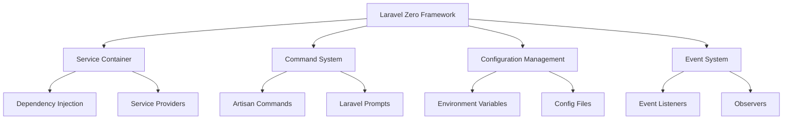

**Key Framework Components:**

1. **Service Container**
   - Automatic dependency resolution
   - Singleton and transient service registration
   - Interface binding to concrete implementations

2. **Command System**
   - Artisan command infrastructure
   - Input validation and parsing
   - Output formatting and styling

3. **Configuration Management**
   - Environment-based configuration
   - Hierarchical configuration merging
   - Type-safe configuration access

### 3.2.2. Application Bootstrap Process

```php
<?php
// bootstrap/app.php - Application initialization

declare(strict_types=1);

use Illuminate\Foundation\Application;
use Illuminate\Foundation\Configuration\Exceptions;
use Illuminate\Foundation\Configuration\Middleware;

return Application::configure(basePath: dirname(__DIR__))
    ->withProviders([
        App\Providers\AppServiceProvider::class,
        App\Providers\ValidateLinksServiceProvider::class,
    ])
    ->withCommands([
        App\Commands\ValidateCommand::class,
        App\Commands\FixCommand::class,
        App\Commands\ReportCommand::class,
        App\Commands\ConfigCommand::class,
    ])
    ->withExceptions(function (Exceptions $exceptions) {
        // Exception handling configuration
    })
    ->create();
```

## 3.3. Service Architecture

### 3.3.1. Service Layer Design

The application implements a comprehensive service layer that encapsulates business logic and provides clear interfaces for different validation concerns.

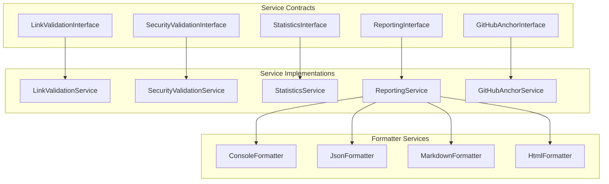

### 3.3.2. Core Service Contracts

**LinkValidationInterface**
```php
<?php

declare(strict_types=1);

namespace App\Services\Contracts;

interface LinkValidationInterface
{
    public function validateFile(string $filePath, array $scope): array;
    public function validateLinks(array $links, array $scope): array;
    public function validateExternalLinks(array $links): array;
    public function validateInternalLinks(array $links, string $basePath): array;
    public function validateAnchorLinks(array $links, string $content): array;
    public function validateCrossReferences(array $files): array;
    public function extractLinks(string $content): array;
    public function categorizeLinks(array $links): array;
}
```

**SecurityValidationInterface**
```php
<?php

declare(strict_types=1);

namespace App\Services\Contracts;

interface SecurityValidationInterface
{
    public function validatePath(string $path): bool;
    public function validateUrl(string $url): bool;
    public function validateFileSize(string $filePath): bool;
    public function sanitizePath(string $path): string;
    public function isPathTraversalAttempt(string $path): bool;
}
```

**ReportingInterface**
```php
<?php

declare(strict_types=1);

namespace App\Services\Contracts;

interface ReportingInterface
{
    public function generateReport(array $results, string $format = 'console'): string;
    public function saveReport(string $content, string $filePath): bool;
    public function getSupportedFormats(): array;
    public function generateSummary(array $results): array;
}
```

**StatisticsInterface**
```php
<?php

declare(strict_types=1);

namespace App\Services\Contracts;

interface StatisticsInterface
{
    public function reset(): void;
    public function incrementFilesProcessed(): void;
    public function addLinkStats(string $type, int $total, int $broken): void;
    public function recordBrokenLink(string $link, string $file, string $reason, string $type): void;
    public function getStatistics(): array;
    public function getTotalBrokenLinks(): int;
    public function getProcessedFiles(): array;
    public function getBrokenLinks(): array;
}
```

**GitHubAnchorInterface**
```php
<?php

declare(strict_types=1);

namespace App\Services\Contracts;

interface GitHubAnchorInterface
{
    public function generateAnchor(string $heading): string;
    public function extractHeadings(string $content): array;
    public function validateAnchor(string $anchor, array $headings): bool;
    public function getAlgorithmVersion(): string;
}
```

### 3.3.3. Service Provider Architecture

The application uses Laravel's service provider pattern to register and configure services with proper dependency injection. Understanding the service registration lifecycle is crucial for proper application architecture.

#### **Service Registration Lifecycle**

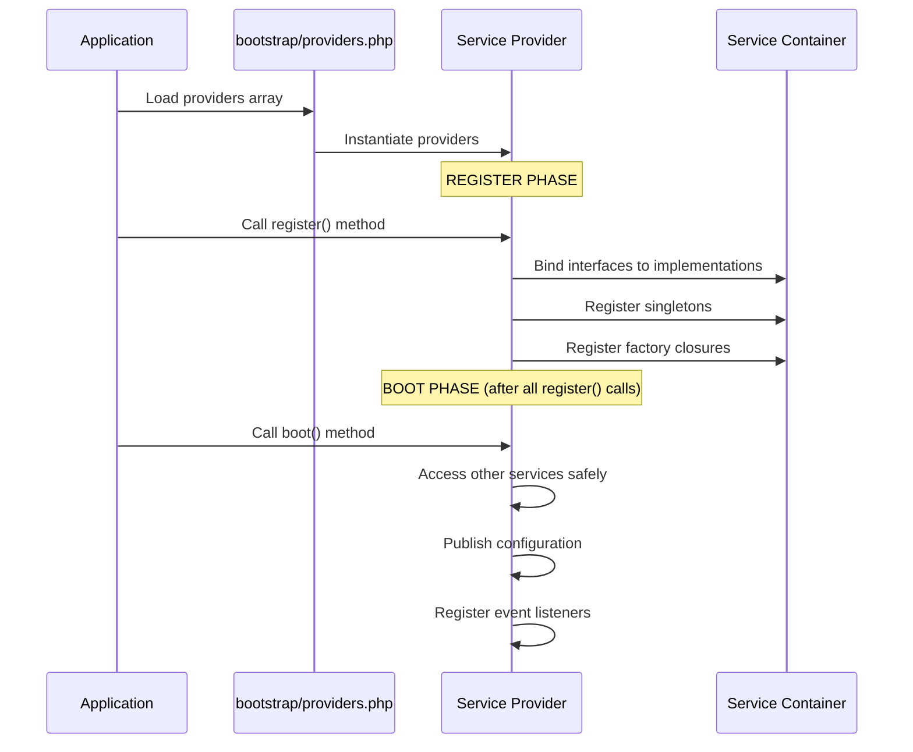

#### **Provider Registration in bootstrap/providers.php**

**Laravel 12 Approach:** Service providers are registered in the providers array:

```php
<?php
// bootstrap/providers.php

return [
    App\Providers\AppServiceProvider::class,
    App\Providers\ValidateLinksServiceProvider::class,
];
```

**Benefits of this approach:**
- **Performance:** Providers loaded only when needed
- **Organization:** Clear separation of concerns
- **Maintainability:** Easy to add/remove providers
- **Testing:** Individual providers can be tested in isolation

**Laravel 12 Improvements:**
- **Enhanced Service Container:** Improved performance and memory usage
- **Better Error Handling:** More descriptive error messages for service resolution
- **Modern PHP Features:** Full support for PHP 8.4+ features including typed properties and enums
- **Security Enhancements:** Updated security practices and vulnerability mitigations

#### **register() vs boot() Methods**

**🔗 Detailed Guide:** [Service Registration Implementation](020-implementation-guide.md#21-service-implementation-completion)

##### **register() Method - Service Binding Phase**
- **Called FIRST** for all providers
- **Purpose:** Bind services into the container
- **Restrictions:** ❌ Don't access other services here
- **Use for:** Interface bindings, singleton registrations

##### **boot() Method - Configuration Phase**
- **Called SECOND** after all register() methods complete
- **Purpose:** Configure services and access dependencies
- **Safe to:** ✅ Access other services, publish config, register events
- **Use for:** Service configuration, event listeners, middleware

#### **Complete Service Provider Example**

```php
<?php
// app/Providers/ValidateLinksServiceProvider.php

declare(strict_types=1);

namespace App\Providers;

use Illuminate\Support\ServiceProvider;
use Illuminate\Support\Facades\Event;

class ValidateLinksServiceProvider extends ServiceProvider
{
    /**
     * Register services - PHASE 1
     * ⚠️  IMPORTANT: Only bind services here!
     */
    public function register(): void
    {
        // Core services (no dependencies)
        $this->app->singleton(StatisticsInterface::class, StatisticsService::class);
        $this->app->singleton(GitHubAnchorInterface::class, GitHubAnchorService::class);
        $this->app->singleton(SecurityValidationInterface::class, SecurityValidationService::class);

        // Dependent services (use factory closures)
        $this->app->singleton(LinkValidationInterface::class, function ($app) {
            return new LinkValidationService(
                $app->make(SecurityValidationInterface::class),
                $app->make(GitHubAnchorInterface::class)
            );
        });

        $this->app->singleton(ReportingInterface::class, function ($app) {
            return new ReportingService(
                $app->make(StatisticsInterface::class)
            );
        });
    }

    /**
     * Bootstrap services - PHASE 2
     * ✅ Safe to access other services here
     */
    public function boot(): void
    {
        // Publish configuration files
        $this->publishes([
            __DIR__.'/../../config/validate-links.php' => config_path('validate-links.php'),
        ], 'validate-links-config');

        // Register event listeners
        Event::listen(ValidationCompleted::class, ValidationCompletedListener::class);

        // Configure services with dependencies
        $this->configureReportingService();
    }

    /**
     * Configure reporting service with formatters.
     */
    private function configureReportingService(): void
    {
        $reportingService = $this->app->make(ReportingInterface::class);
        $reportingService->addFormatter('console', new ConsoleFormatter());
        $reportingService->addFormatter('json', new JsonFormatter());
        $reportingService->addFormatter('html', new HtmlFormatter());
        $reportingService->addFormatter('markdown', new MarkdownFormatter());
    }
}
```

## 3.4. Value Objects Architecture

### 3.4.1. Value Objects Pattern

Value Objects are immutable data containers that encapsulate related data and provide type safety, validation, and business logic methods. The validate-links application uses Value Objects to represent complex configuration and result data structures.

**Key Characteristics:**
- **Immutability**: All properties are readonly, preventing accidental modification
- **Type Safety**: Strong typing ensures data integrity throughout the application
- **Encapsulation**: Related data and behavior are grouped together
- **Factory Methods**: Static constructors provide convenient object creation
- **Business Logic**: Methods that operate on the encapsulated data

### 3.4.2. ValidationConfig Value Object

The `ValidationConfig` Value Object encapsulates all validation configuration parameters, providing a type-safe way to pass configuration throughout the application.

```php
<?php

declare(strict_types=1);

namespace App\Services\ValueObjects;

final readonly class ValidationConfig
{
    public function __construct(
        public array $paths = [],
        public array $scope = ['internal', 'anchor'],
        public int $maxDepth = 0,
        public bool $includeHidden = false,
        public bool $onlyHidden = false,
        public array $excludePatterns = [],
        public bool $checkExternal = false,
        public bool $caseSensitive = false,
        public int $timeout = 30,
        public string $format = 'console',
        public ?string $output = null,
        public bool $noColor = false,
        public string $verbosity = 'normal',
        public int $maxBroken = 50,
        public int $maxFiles = 0,
        public bool $dryRun = false,
        public bool $fix = false,
        public bool $interactive = false,
        public ?string $configFile = null,
        public bool $showHelp = false
    ) {}

    // Factory methods for convenient object creation
    public static function fromCommandOptions(array $options, array $arguments = []): self;
    public static function withDefaults(array $overrides = []): self;

    // Business logic methods
    public function shouldValidateScope(string $scope): bool;
    public function shouldCheckExternal(): bool;
    public function shouldStopEarly(int $brokenCount): bool;
    public function toArray(): array;
}
```

**Usage Example:**
```php
// Create from command options
$config = ValidationConfig::fromCommandOptions($options, $arguments);

// Use business logic methods
if ($config->shouldValidateScope('external')) {
    $timeout = $config->getExternalTimeout();
    // Validate external links with timeout
}
```

### 3.4.3. ValidationResult Value Object

The `ValidationResult` Value Object encapsulates validation results, providing methods for result analysis and reporting.

```php
<?php

declare(strict_types=1);

namespace App\Services\ValueObjects;

final readonly class ValidationResult
{
    public function __construct(
        public array $statistics,
        public array $brokenLinks,
        public array $processedFiles,
        public float $executionTime = 0.0,
        public int $exitCode = 0,
        public array $errors = [],
        public array $warnings = []
    ) {}

    // Factory methods for different result types
    public static function success(array $statistics, array $processedFiles, float $executionTime): self;
    public static function withBrokenLinks(array $statistics, array $brokenLinks, array $processedFiles, float $executionTime): self;
    public static function withErrors(array $errors, float $executionTime = 0.0): self;

    // Business logic methods
    public function isSuccessful(): bool;
    public function hasBrokenLinks(): bool;
    public function getSuccessRate(): float;
    public function getBrokenLinksByType(): array;
    public function getStatisticsSummary(): array;
}
```

**Usage Example:**
```php
// Create result with broken links
$result = ValidationResult::withBrokenLinks($stats, $brokenLinks, $files, $time);

// Analyze results
if (!$result->isSuccessful()) {
    $successRate = $result->getSuccessRate();
    $summary = $result->getStatisticsSummary();
    // Generate failure report
}
```

### 3.4.4. Value Objects Benefits

**Type Safety:**
- Eliminates array-based parameter passing
- Provides compile-time type checking
- Reduces runtime errors from invalid data

**Immutability:**
- Prevents accidental data modification
- Enables safe sharing between services
- Simplifies debugging and testing

**Encapsulation:**
- Groups related data and behavior
- Provides clear API boundaries
- Improves code organization and maintainability

**Testing:**
- Easy to create test fixtures
- Predictable behavior due to immutability
- Clear separation of concerns

## 3.5. Formatter Architecture

### 3.5.1. Output Formatting System

The validate-links application provides a flexible output formatting system that supports multiple output formats for validation results. The formatter architecture uses a duck-typing approach where formatters implement different signatures based on their output requirements.

**Formatter Types:**
- **Console Formatters**: Output directly to console with colors and interactive elements
- **File Formatters**: Return formatted strings for file output (JSON, Markdown, HTML)

### 3.5.2. Formatter Patterns

**Console Formatter Pattern:**
```php
public function format(ValidationResult $result, Command $command): void
```
Console formatters receive both the validation result and the command instance to output directly to the console with colors, tables, and interactive elements.

**File Formatter Pattern:**
```php
public function format(ValidationResult $result): string
```
File formatters receive only the validation result and return a formatted string that can be saved to files or output to stdout.

### 3.5.3. Core Formatters

**ConsoleFormatter**
```php
<?php

declare(strict_types=1);

namespace App\Services\Formatters;

use App\Services\ValueObjects\ValidationResult;
use Illuminate\Console\Command;

final class ConsoleFormatter
{
    public function format(ValidationResult $result, Command $command): void
    {
        $this->displayHeader($command);
        $this->displayStatistics($result, $command);
        
        if ($result->hasBrokenLinks()) {
            $this->displayBrokenLinks($result, $command);
        }
        
        $this->displaySummary($result, $command);
    }

    // Private methods for different display sections
    private function displayHeader(Command $command): void;
    private function displayStatistics(ValidationResult $result, Command $command): void;
    private function displayBrokenLinks(ValidationResult $result, Command $command): void;
    private function displaySummary(ValidationResult $result, Command $command): void;
}
```

**JsonFormatter**
```php
<?php

declare(strict_types=1);

namespace App\Services\Formatters;

use App\Services\ValueObjects\ValidationResult;

final class JsonFormatter
{
    public function format(ValidationResult $result): string
    {
        $data = [
            'validation_result' => [
                'success' => $result->isSuccessful(),
                'exit_code' => $result->exitCode,
                'summary' => $result->getStatisticsSummary(),
                'statistics' => $result->statistics,
                'broken_links' => $result->brokenLinks,
                'processed_files' => $result->processedFiles,
                'execution_time' => $result->executionTime,
                'timestamp' => date('c'),
            ],
        ];

        return json_encode($data, JSON_PRETTY_PRINT | JSON_UNESCAPED_SLASHES);
    }
}
```

**MarkdownFormatter**
```php
<?php

declare(strict_types=1);

namespace App\Services\Formatters;

use App\Services\ValueObjects\ValidationResult;

final class MarkdownFormatter
{
    public function format(ValidationResult $result): string
    {
        // Generates GitHub-flavored markdown report
        // with tables, headers, and formatted sections
    }
}
```

**HtmlFormatter**
```php
<?php

declare(strict_types=1);

namespace App\Services\Formatters;

use App\Services\ValueObjects\ValidationResult;

final class HtmlFormatter
{
    public function format(ValidationResult $result): string
    {
        // Generates HTML report with CSS styling
        // and interactive elements
    }
}
```

### 3.5.4. Formatter Registration

Formatters are registered in the configuration and service provider:

```php
// config/validate-links.php
'formats' => [
    'console' => [
        'class' => App\Services\Formatters\ConsoleFormatter::class,
        'options' => [
            'colors' => true,
            'progress_bars' => true,
        ],
    ],
    'json' => [
        'class' => App\Services\Formatters\JsonFormatter::class,
        'options' => [
            'pretty_print' => true,
            'include_metadata' => true,
        ],
    ],
    'markdown' => [
        'class' => App\Services\Formatters\MarkdownFormatter::class,
        'options' => [
            'include_toc' => true,
            'github_flavored' => true,
        ],
    ],
    'html' => [
        'class' => App\Services\Formatters\HtmlFormatter::class,
        'options' => [
            'template' => 'default',
            'include_css' => true,
        ],
    ],
],
```

### 3.5.5. Usage Examples

**Console Output:**
```php
$formatter = new ConsoleFormatter();
$formatter->format($result, $command); // Outputs directly to console
```

**File Output:**
```php
$jsonFormatter = new JsonFormatter();
$jsonOutput = $jsonFormatter->format($result);
file_put_contents('report.json', $jsonOutput);

$markdownFormatter = new MarkdownFormatter();
$markdownOutput = $markdownFormatter->format($result);
file_put_contents('report.md', $markdownOutput);
```

### 3.5.6. Extensibility

The formatter system supports custom formatters by following the established patterns:

```php
final class CustomFormatter
{
    public function format(ValidationResult $result): string
    {
        // Custom formatting logic
        return $formattedOutput;
    }
}
```

## 3.6. Command Architecture

### 3.6.1. Command Hierarchy

The application implements a hierarchical command structure with shared functionality and specialized implementations.

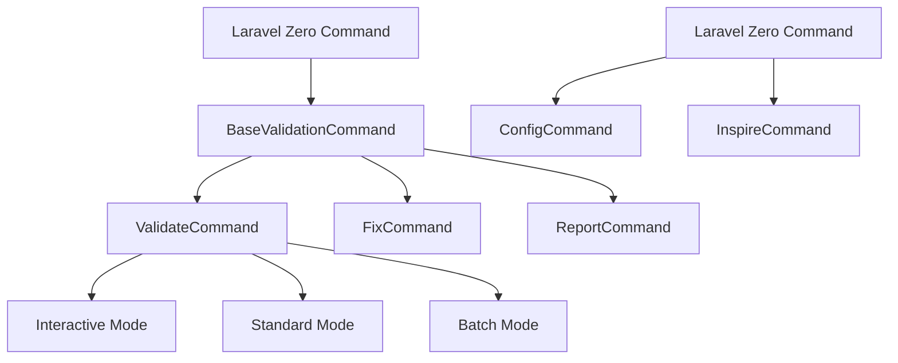

### 3.4.2. BaseValidationCommand Architecture

```php
<?php
// app/Commands/BaseValidationCommand.php

declare(strict_types=1);

namespace App\Commands;

use LaravelZero\Framework\Commands\Command;
use App\Services\Contracts\LinkValidationInterface;
use App\Services\Contracts\ReportingInterface;
use App\Services\Contracts\SecurityValidationInterface;

abstract class BaseValidationCommand extends Command
{
    protected LinkValidationInterface $linkValidationService;
    protected ReportingInterface $reportingService;
    protected SecurityValidationInterface $securityService;

    public function __construct(
        LinkValidationInterface $linkValidationService,
        ReportingInterface $reportingService,
        SecurityValidationInterface $securityService
    ) {
        parent::__construct();
        
        $this->linkValidationService = $linkValidationService;
        $this->reportingService = $reportingService;
        $this->securityService = $securityService;
    }

    protected function validatePaths(array $paths): array
    {
        $validPaths = [];
        
        foreach ($paths as $path) {
            if ($this->securityService->validatePath($path)) {
                $validPaths[] = $path;
            } else {
                $this->warn("Skipping invalid path: {$path}");
            }
        }
        
        return $validPaths;
    }

    protected function displaySummary(array $summary): void
    {
        $this->newLine();
        $this->info('📊 Validation Summary');
        $this->table(
            ['Metric', 'Count'],
            [
                ['Total Files', $summary['total_files']],
                ['Total Links', $summary['total_links']],
                ['Broken Links', $summary['broken_links']],
                ['External Links', $summary['external_links']],
                ['Internal Links', $summary['internal_links']],
                ['Anchor Links', $summary['anchor_links']],
            ]
        );
    }
}
```

### 3.4.3. Command Signature Architecture

Laravel Zero's command signature system provides type-safe argument and option parsing with built-in validation.

```php
<?php
// app/Commands/ValidateCommand.php

class ValidateCommand extends BaseValidationCommand
{
    protected $signature = 'validate 
        {path* : Paths to validate (files or directories)}
        {--scope=* : Validation scope (internal,anchor,cross-reference,external,all)}
        {--max-depth=0 : Maximum directory traversal depth (0 = unlimited)}
        {--include-hidden : Include hidden files and directories}
        {--exclude=* : Exclude patterns (glob format)}
        {--check-external : Validate external links (may be slow)}
        {--timeout=30 : External link timeout in seconds}
        {--format=console : Output format (console,json,markdown,html)}
        {--output= : Output file path (stdout if not specified)}
        {--max-broken=50 : Maximum broken links before stopping (0 = unlimited)}
        {--dry-run : Preview mode - show what would be validated}
        {--fix : Enable automatic link fixing where possible}
        {--interactive : Interactive mode with prompts}
        {--cache : Enable caching for external link validation}
        {--no-progress : Disable progress bars}
        {--verbose : Verbose output with detailed information}';

    protected $description = 'Validate links in markdown files and directories';
}
```

## 3.5. Data Flow Architecture

### 3.5.1. Validation Pipeline

The application implements a comprehensive validation pipeline that processes files through multiple validation stages.

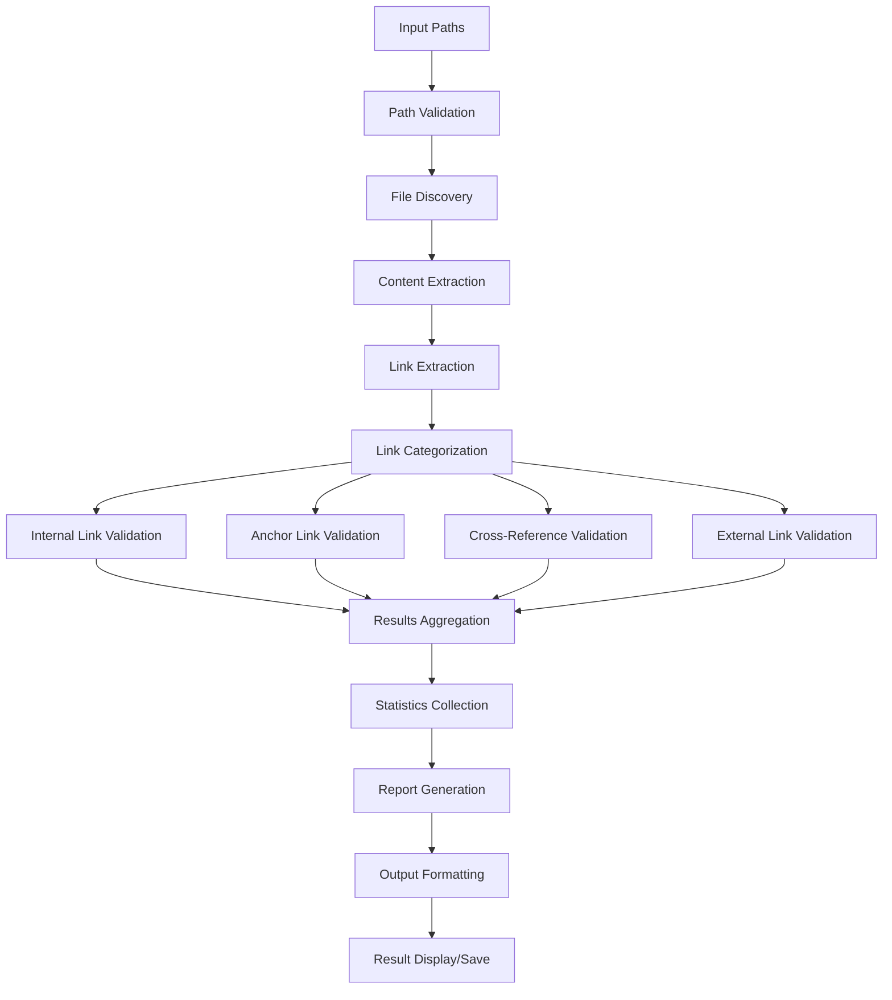

### 3.5.2. Link Processing Architecture

```php
<?php

// Link processing flow in LinkValidationService
    public function validateFile(string $file, array|ValidationConfig $scope): array
    {
        // 1. Security validation
        if (!$this->securityService->validatePath($file)) {
            throw new SecurityException("Invalid file path: {$file}");
        }

        // 2. Content extraction
        $content = $this->extractContent($file);

        // 3. Link extraction
        $links = $this->extractLinks($content);

        // 4. Link categorization
        $categorizedLinks = $this->categorizeLinks($links);

        // 5. Scope-based validation
        $results = [];

        if (in_array('internal', $scope)) {
            $results['internal'] = $this->validateInternalLinks(
                $categorizedLinks['internal'],
                dirname($file)
            );
        }

        if (in_array('anchor', $scope)) {
            $results['anchor'] = $this->validateAnchorLinks(
                $categorizedLinks['anchor'],
                $content
            );
        }

        if (in_array('external', $scope)) {
            $results['external'] = $this->validateExternalLinks(
                $categorizedLinks['external']
            );
        }

        // 6. Statistics collection
        $this->statisticsService->recordValidation($file, $results);

        return [
            'file' => $file,
            'links' => $this->flattenResults($results),
            'summary' => $this->generateFileSummary($results),
        ];
    }
```php
```

## 3.6. Configuration Architecture

### 3.6.1. Configuration Hierarchy

The application implements a hierarchical configuration system that supports environment-specific settings and runtime overrides.

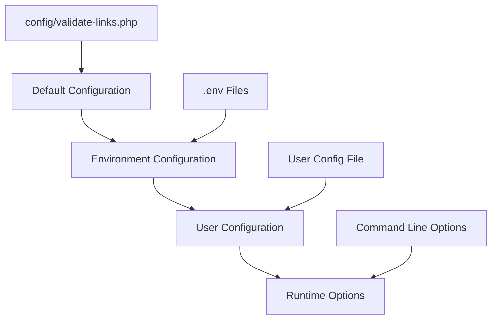

### 3.6.2. Configuration Structure

```php
<?php
// config/validate-links.php

declare(strict_types=1);

return [
    /*
    |--------------------------------------------------------------------------
    | Default Validation Settings
    |--------------------------------------------------------------------------
    */
    'defaults' => [
        'max_depth' => env('VALIDATE_LINKS_MAX_DEPTH', 0),
        'timeout' => env('VALIDATE_LINKS_TIMEOUT', 30),
        'max_broken' => env('VALIDATE_LINKS_MAX_BROKEN', 50),
        'concurrency' => env('VALIDATE_LINKS_CONCURRENCY', 10),
        'include_hidden' => env('VALIDATE_LINKS_INCLUDE_HIDDEN', false),
    ],

    /*
    |--------------------------------------------------------------------------
    | Security Configuration
    |--------------------------------------------------------------------------
    */
    'security' => [
        'allowed_protocols' => ['http', 'https', 'ftp', 'ftps'],
        'blocked_domains' => [
            'localhost',
            '127.0.0.1',
            '0.0.0.0',
        ],
        'blocked_paths' => [
            '/etc/*',
            '/var/*',
            '~/*',
        ],
        'max_file_size' => 10 * 1024 * 1024, // 10MB
        'path_traversal_protection' => true,
    ],

    /*
    |--------------------------------------------------------------------------
    | Performance Configuration
    |--------------------------------------------------------------------------
    */
    'performance' => [
        'cache_enabled' => env('VALIDATE_LINKS_CACHE_ENABLED', true),
        'cache_ttl' => env('VALIDATE_LINKS_CACHE_TTL', 86400), // 24 hours
        'memory_limit' => env('VALIDATE_LINKS_MEMORY_LIMIT', '512M'),
        'max_execution_time' => env('VALIDATE_LINKS_MAX_EXECUTION_TIME', 300),
        'batch_size' => env('VALIDATE_LINKS_BATCH_SIZE', 100),
    ],

    /*
    |--------------------------------------------------------------------------
    | Output Format Configuration
    |--------------------------------------------------------------------------
    */
    'formats' => [
        'console' => [
            'class' => App\Services\Formatters\ConsoleFormatter::class,
            'options' => [
                'colors' => true,
                'progress_bars' => true,
            ],
        ],
        'json' => [
            'class' => App\Services\Formatters\JsonFormatter::class,
            'options' => [
                'pretty_print' => true,
                'include_metadata' => true,
            ],
        ],
        'markdown' => [
            'class' => App\Services\Formatters\MarkdownFormatter::class,
            'options' => [
                'include_toc' => true,
                'github_flavored' => true,
            ],
        ],
        'html' => [
            'class' => App\Services\Formatters\HtmlFormatter::class,
            'options' => [
                'template' => 'default',
                'include_css' => true,
            ],
        ],
    ],

    /*
    |--------------------------------------------------------------------------
    | File Pattern Configuration
    |--------------------------------------------------------------------------
    */
    'patterns' => [
        'include' => [
            '*.md',
            '*.markdown',
            '*.rst',
            '*.txt',
        ],
        'exclude' => [
            'node_modules/**/*',
            'vendor/**/*',
            '.git/**/*',
            '.ai/**/*.md',
            'build/**/*',
            'dist/**/*',
        ],
    ],

    /*
    |--------------------------------------------------------------------------
    | Link Extraction Configuration
    |--------------------------------------------------------------------------
    */
    'extraction' => [
        'markdown_links' => true,
        'html_links' => true,
        'reference_links' => true,
        'image_links' => false,
        'email_links' => false,
    ],

    /*
    |--------------------------------------------------------------------------
    | Validation Scope Configuration
    |--------------------------------------------------------------------------
    */
    'scopes' => [
        'internal' => [
            'enabled' => true,
            'check_existence' => true,
            'follow_symlinks' => false,
        ],
        'anchor' => [
            'enabled' => true,
            'github_style' => true,
            'case_sensitive' => false,
        ],
        'cross_reference' => [
            'enabled' => true,
            'resolve_relative_paths' => true,
        ],
        'external' => [
            'enabled' => false, // Disabled by default for performance
            'timeout' => 30,
            'user_agent' => 'validate-links/1.0',
            'follow_redirects' => true,
            'max_redirects' => 5,
        ],
    ],
];
```

## 3.7. Error Handling Architecture

### 3.7.1. Exception Hierarchy

The application implements a comprehensive exception hierarchy for different types of validation errors.

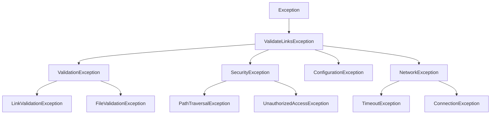

### 3.7.2. Error Handling Implementation

```php
<?php
// app/Exceptions/ValidateLinksException.php

declare(strict_types=1);

namespace App\Exceptions;

use Exception;

abstract class ValidateLinksException extends Exception
{
    protected array $context = [];

    public function __construct(string $message, array $context = [], int $code = 0, ?Exception $previous = null)
    {
        $this->context = $context;
        parent::__construct($message, $code, $previous);
    }

    public function getContext(): array
    {
        return $this->context;
    }

    abstract public function getErrorCode(): string;
    abstract public function getSeverity(): string;
}
```

```php
<?php
// app/Exceptions/Handler.php

declare(strict_types=1);

namespace App\Exceptions;

use Illuminate\Foundation\Exceptions\Handler as ExceptionHandler;
use Throwable;

class Handler extends ExceptionHandler
{
    public function render($request, Throwable $exception)
    {
        if ($exception instanceof ValidateLinksException) {
            return $this->renderValidateLinksException($exception);
        }

        return parent::render($request, $exception);
    }

    private function renderValidateLinksException(ValidateLinksException $exception): void
    {
        $output = app('Illuminate\Contracts\Console\Kernel')->output();
        
        $output->writeln("<error>Error [{$exception->getErrorCode()}]: {$exception->getMessage()}</error>");
        
        if ($exception->getContext()) {
            $output->writeln("<comment>Context:</comment>");
            foreach ($exception->getContext() as $key => $value) {
                $output->writeln("  <info>{$key}:</info> {$value}");
            }
        }
        
        if (config('app.debug')) {
            $output->writeln("<comment>Stack trace:</comment>");
            $output->writeln($exception->getTraceAsString());
        }
    }
}
```

## 3.8. Performance Architecture

### 3.8.1. Caching Strategy

The application implements a multi-layer caching strategy to optimize performance for repeated validations.

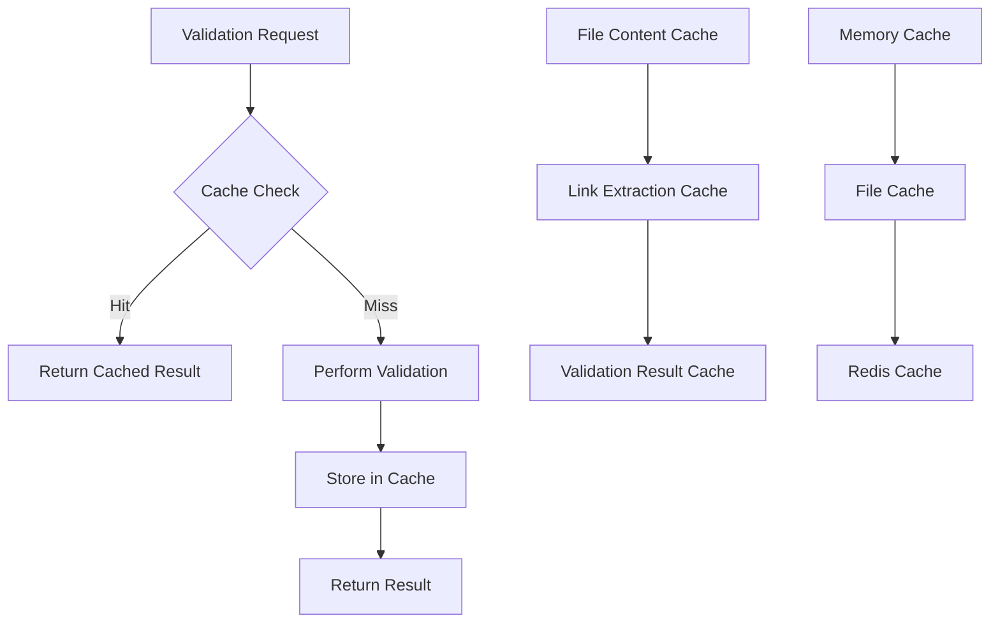

### 3.8.2. Concurrent Processing Architecture

```php
<?php
// app/Services/ConcurrentValidationService.php

declare(strict_types=1);

namespace App\Services;

use GuzzleHttp\Pool;
use GuzzleHttp\Client;
use GuzzleHttp\Psr7\Request;
use Illuminate\Support\Collection;

class ConcurrentValidationService
{
    private Client $httpClient;
    private int $concurrency;

    public function __construct(int $concurrency = 10)
    {
        $this->concurrency = $concurrency;
        $this->httpClient = new Client([
            'timeout' => config('validate-links.defaults.timeout'),
            'headers' => [
                'User-Agent' => config('validate-links.scopes.external.user_agent'),
            ],
        ]);
    }

    public function validateExternalLinksConcurrently(array $links): array
    {
        $requests = $this->createRequests($links);
        $results = [];

        $pool = new Pool($this->httpClient, $requests, [
            'concurrency' => $this->concurrency,
            'fulfilled' => function ($response, $index) use (&$results, $links) {
                $results[$index] = $this->processSuccessfulResponse($response, $links[$index]);
            },
            'rejected' => function ($reason, $index) use (&$results, $links) {
                $results[$index] = $this->processFailedResponse($reason, $links[$index]);
            },
        ]);

        $promise = $pool->promise();
        $promise->wait();

        return $results;
    }

    private function createRequests(array $links): \Generator
    {
        foreach ($links as $index => $link) {
            yield $index => new Request('HEAD', $link['url']);
        }
    }
}
```

## 3.9. Testing Architecture

### 3.9.1. Testing Strategy

The application implements a comprehensive testing strategy with multiple testing layers.

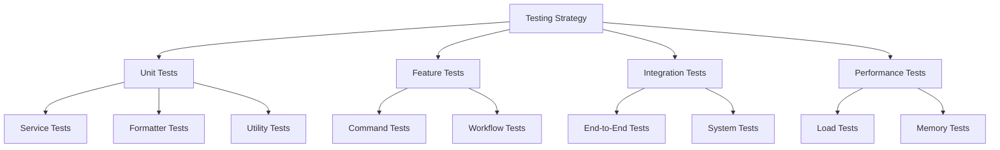

### 3.9.2. Test Architecture Implementation

```php
<?php
// tests/TestCase.php

declare(strict_types=1);

namespace Tests;

use LaravelZero\Framework\Testing\TestCase as BaseTestCase;
use Illuminate\Foundation\Testing\RefreshDatabase;

abstract class TestCase extends BaseTestCase
{
    use CreatesApplication;

    protected function setUp(): void
    {
        parent::setUp();
        
        // Set up test environment
        config(['validate-links.cache.enabled' => false]);
        config(['validate-links.performance.memory_limit' => '256M']);
    }

    protected function createTestFile(string $path, string $content): string
    {
        $fullPath = $this->getTestPath($path);
        $directory = dirname($fullPath);
        
        if (!is_dir($directory)) {
            mkdir($directory, 0755, true);
        }
        
        file_put_contents($fullPath, $content);
        
        return $fullPath;
    }

    protected function getTestPath(string $path): string
    {
        return __DIR__ . '/fixtures/' . ltrim($path, '/');
    }

    protected function cleanupTestFiles(): void
    {
        $fixturesPath = __DIR__ . '/fixtures';
        if (is_dir($fixturesPath)) {
            $this->deleteDirectory($fixturesPath);
        }
    }
}
```

## 3.10. Extensibility Architecture

### 3.10.1. Plugin System Design

The application is designed with extensibility in mind, allowing for custom validators, formatters, and processors.

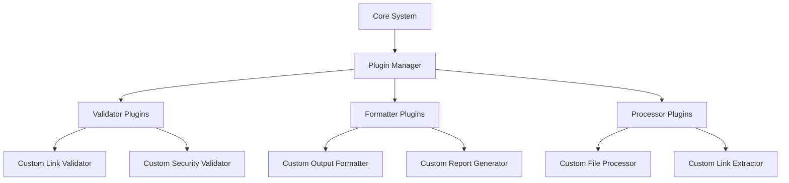

### 3.10.2. Extension Points

```php
<?php
// app/Contracts/ExtensionInterface.php

declare(strict_types=1);

namespace App\Contracts;

interface ExtensionInterface
{
    public function getName(): string;
    public function getVersion(): string;
    public function getDescription(): string;
    public function register(): void;
    public function boot(): void;
}
```

```php
<?php
// app/Services/PluginManager.php

declare(strict_types=1);

namespace App\Services;

use App\Contracts\ExtensionInterface;
use Illuminate\Support\Collection;

class PluginManager
{
    private Collection $plugins;

    public function __construct()
    {
        $this->plugins = new Collection();
    }

    public function register(ExtensionInterface $plugin): void
    {
        $this->plugins->put($plugin->getName(), $plugin);
        $plugin->register();
    }

    public function boot(): void
    {
        $this->plugins->each(function (ExtensionInterface $plugin) {
            $plugin->boot();
        });
    }

    public function getPlugin(string $name): ?ExtensionInterface
    {
        return $this->plugins->get($name);
    }
}
```

## 3.11. Security Architecture

### 3.11.1. Security Layers

The application implements multiple security layers to protect against various attack vectors.

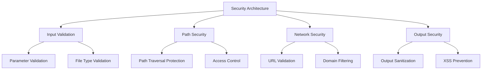

### 3.11.2. Security Implementation

```php
<?php
// app/Services/SecurityValidationService.php

namespace App\Services;

use App\Services\Contracts\SecurityValidationInterface;
use App\Exceptions\SecurityException;

class SecurityValidationService implements SecurityValidationInterface
{
    private array $blockedDomains;
    private array $allowedProtocols;
    private array $blockedPaths;

    public function validatePath(string $path): bool
    {
        // Normalize path
        $realPath = realpath($path);
        
        if ($realPath === false) {
            return false;
        }

        // Check for path traversal
        if ($this->isPathTraversalAttempt($path)) {
            throw new SecurityException('Path traversal attempt detected', ['path' => $path]);
        }

        // Check against blocked patterns
        foreach ($this->blockedPaths as $pattern) {
            if (fnmatch($pattern, $realPath)) {
                return false;
            }
        }

        // Ensure path is within project boundaries
        $basePath = getcwd();
        return str_starts_with($realPath, $basePath);
    }

    public function validateUrl(string $url): bool
    {
        // Basic URL validation
        if (!filter_var($url, FILTER_VALIDATE_URL)) {
            return false;
        }

        $parsed = parse_url($url);
        
        // Protocol validation
        if (!in_array($parsed['scheme'] ?? '', $this->allowedProtocols)) {
            return false;
        }

        // Domain validation
        $host = $parsed['host'] ?? '';
        foreach ($this->blockedDomains as $blocked) {
            if (str_ends_with($host, $blocked)) {
                return false;
            }
        }

        return true;
    }
}
```

## 3.12. Monitoring and Observability

### 3.12.1. Logging Architecture

The application implements comprehensive logging for monitoring and debugging purposes.

```php
<?php
// app/Services/LoggingService.php

namespace App\Services;

use Illuminate\Support\Facades\Log;
use Monolog\Logger;

class LoggingService
{
    private Logger $logger;

    public function __construct()
    {
        $this->logger = Log::channel(config('validate-links.logging.channel', 'single'));
    }

    public function logValidationStart(array $paths, array $scope): void
    {
        $this->logger->info('Validation started', [
            'paths' => $paths,
            'scope' => $scope,
            'timestamp' => now()->toISOString(),
        ]);
    }

    public function logValidationComplete(array $summary): void
    {
        $this->logger->info('Validation completed', [
            'summary' => $summary,
            'timestamp' => now()->toISOString(),
        ]);
    }

    public function logError(string $message, array $context = []): void
    {
        $this->logger->error($message, $context);
    }
}
```

### 3.12.2. Metrics Collection

```php
<?php
// app/Services/MetricsService.php

namespace App\Services;

class MetricsService
{
    private array $metrics = [];

    public function recordValidationTime(float $duration): void
    {
        $this->metrics['validation_time'] = $duration;
    }

    public function recordMemoryUsage(int $bytes): void
    {
        $this->metrics['memory_usage'] = $bytes;
    }

    public function recordLinkCounts(array $counts): void
    {
        $this->metrics['link_counts'] = $counts;
    }

    public function getMetrics(): array
    {
        return $this->metrics;
    }
}
```

## 3.13. Deployment Architecture

### 3.13.1. Build and Distribution

The application supports multiple deployment strategies for different environments and use cases.

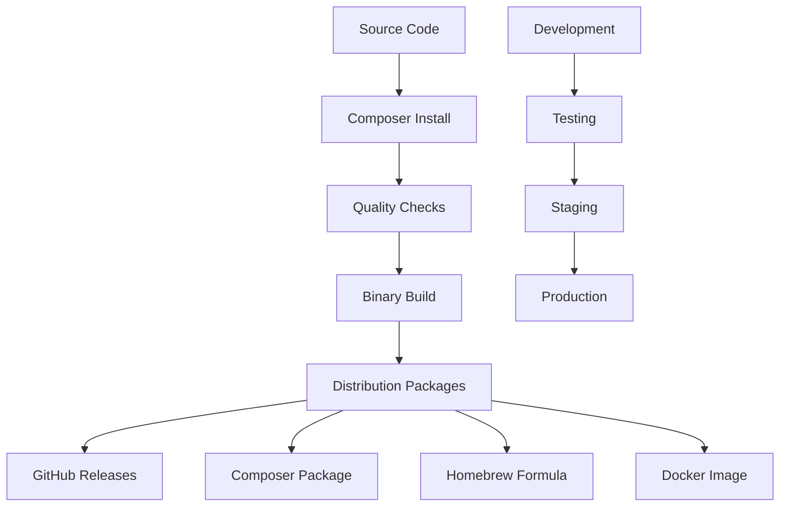

### 3.13.2. Environment Configuration

```php
<?php
// config/environments/production.php

return [
    'app' => [
        'debug' => false,
        'log_level' => 'warning',
    ],
    
    'validate-links' => [
        'performance' => [
            'cache_enabled' => true,
            'concurrency' => 20,
            'memory_limit' => '1024M',
        ],
        
        'security' => [
            'strict_mode' => true,
            'audit_logging' => true,
        ],
    ],
];
```

## 3.14. Architecture Benefits

### 3.14.1. Maintainability

**Service-Oriented Design:**
- Clear separation of concerns
- Single responsibility principle
- Interface-based programming
- Dependency injection for loose coupling

**Laravel Zero Framework:**
- Established patterns and conventions
- Comprehensive testing utilities
- Built-in configuration management
- Extensive ecosystem support

### 3.14.2. Scalability

**Performance Optimizations:**
- Concurrent processing capabilities
- Multi-layer caching strategy
- Memory-efficient processing
- Configurable resource limits

**Extensibility:**
- Plugin system for custom functionality
- Event-driven architecture
- Configurable validation scopes
- Multiple output formats

### 3.14.3. Reliability

**Error Handling:**
- Comprehensive exception hierarchy
- Graceful degradation
- Detailed error reporting
- Recovery mechanisms

**Testing:**
- Multi-layer testing strategy
- Automated quality checks
- Performance testing
- Integration testing

## 3.15. Future Architecture Considerations

### 3.15.1. Planned Enhancements

**Distributed Processing:**
- Queue-based validation for large projects
- Microservice architecture for specialized validation
- API-based validation services
- Cloud-native deployment options

**Advanced Features:**
- Machine learning for link quality assessment
- Real-time validation monitoring
- Integration with CI/CD platforms
- Advanced reporting and analytics

### 3.15.2. Architecture Evolution

The current architecture provides a solid foundation for future enhancements while maintaining backward compatibility and performance. The service-oriented design allows for incremental improvements and feature additions without major architectural changes.

---

## 📖 Navigation

**[⬅️ Previous: Implementation Guide](020-implementation-guide.md)** | **[Next: API Reference ➡️](040-api-reference.md)** | **[🔝 Top](#3-architecture-overview)**
