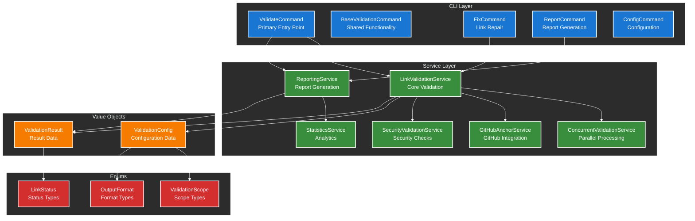
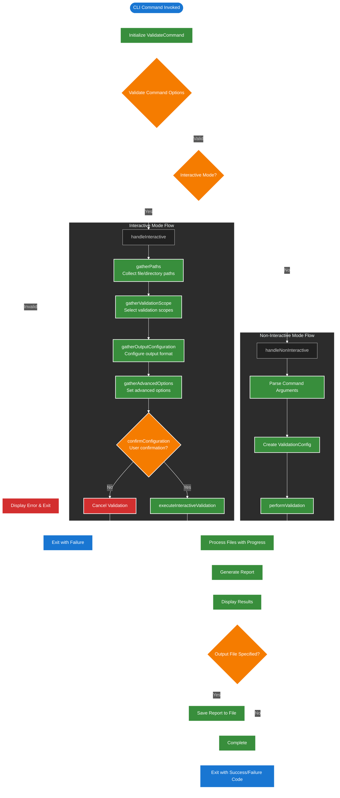
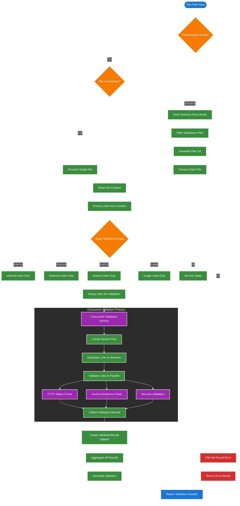
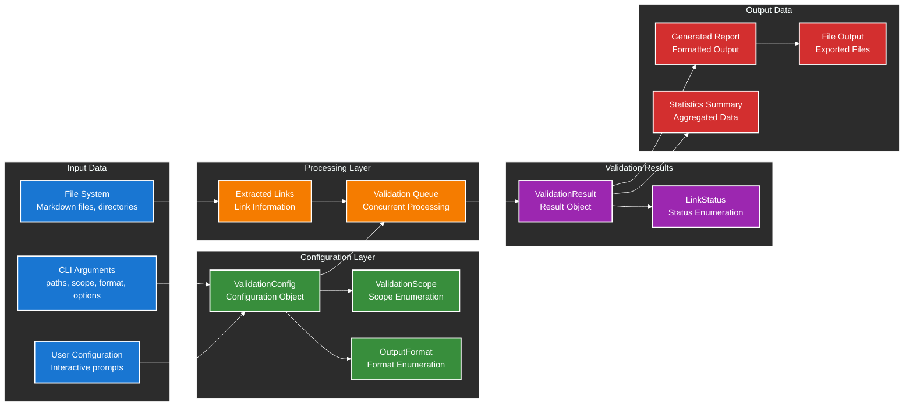
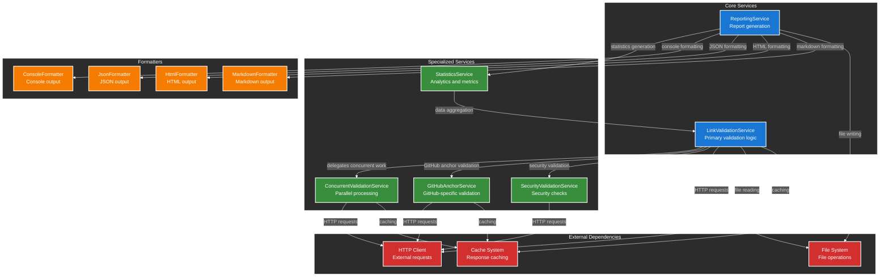
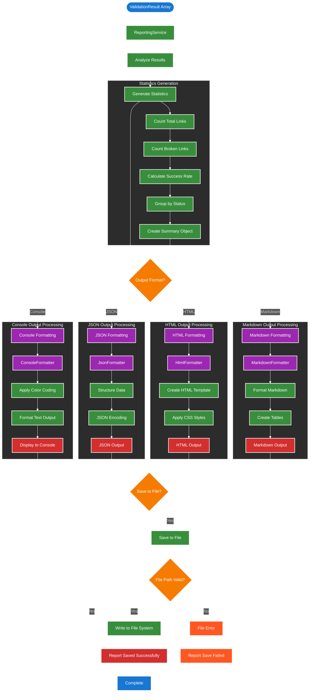
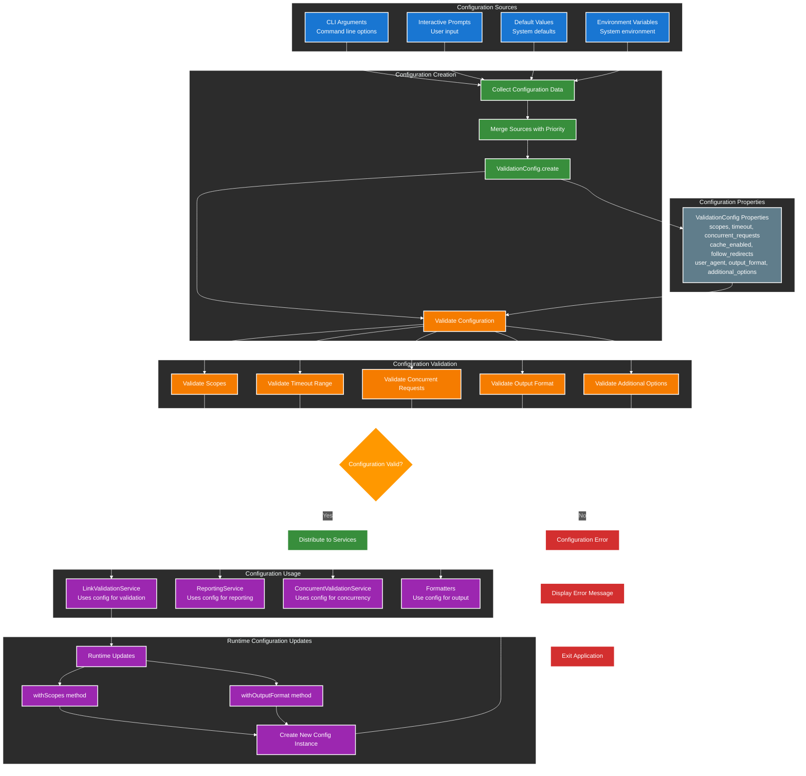

# 1. Validate-Links Application Process and Data Flows

Table of Contents

- [1. Validate-Links Application Process and Data Flows](#1-validate-links-application-process-and-data-flows)
  - [1.1. Overview](#11-overview)
  - [1.2. Application Architecture](#12-application-architecture)
  - [1.3. Command Execution Flow](#13-command-execution-flow)
  - [1.4. Validation Process Flow](#14-validation-process-flow)
  - [1.5. Data Flow Architecture](#15-data-flow-architecture)
  - [1.6. Service Layer Interactions](#16-service-layer-interactions)
  - [1.7. Reporting and Output Generation](#17-reporting-and-output-generation)
  - [1.8. Configuration Management](#18-configuration-management)

## 1.1. Overview

The validate-links application is a comprehensive Laravel Zero CLI tool designed for validating links in documentation files. This document provides detailed process and data flow diagrams using color-keyed mermaid diagrams to illustrate the application's architecture and operational flows.

**Key Features:**
- Interactive and non-interactive validation modes
- Multiple validation scopes (internal, external, anchor, image, all)
- Various output formats (console, JSON, HTML, markdown)
- Concurrent link validation
- Comprehensive reporting and statistics

## 1.2. Application Architecture

**Color Key:**
- **Blue (#1976d2)**: Primary entities and key components (Commands)
- **Green (#388e3c)**: Service layer components and relationships
- **Orange (#f57c00)**: Data structures and value objects
- **Red (#d32f2f)**: Enums and validation constraints

## 1.3. Command Execution Flow

The ValidateCommand serves as the primary entry point for the application, supporting both interactive and non-interactive modes. This diagram illustrates the complete command execution flow from initialization to completion.

**Process Flow Details:**

1. **Initialization**: Command options are validated using enum validation
2. **Mode Selection**: Determines interactive vs non-interactive execution path
3. **Interactive Mode**: Guided setup with user prompts for configuration
4. **Non-Interactive Mode**: Direct execution using command-line arguments
5. **Validation Execution**: Files are processed with real-time progress feedback
6. **Report Generation**: Results are formatted according to specified output format
7. **Output Handling**: Results displayed and optionally saved to file

## 1.4. Validation Process Flow

This diagram illustrates the detailed validation process that occurs within the LinkValidationService, showing how files are processed, links are extracted, and validation is performed concurrently.

**Validation Process Details:**

1. **File Discovery**: Handles both single files and directory scanning with recursive traversal
2. **Content Extraction**: Reads file content and extracts links using regex patterns
3. **Scope Filtering**: Applies validation scope filters (internal, external, anchor, image, all)
4. **Concurrent Processing**: Distributes links across worker pool for parallel validation
5. **Multi-Type Validation**: Performs HTTP checks, anchor validation, and security checks
6. **Result Aggregation**: Collects and aggregates all validation results with statistics
7. **Error Handling**: Comprehensive error handling for file access and validation failures

## 1.5. Data Flow Architecture

This diagram illustrates how data flows through the application, from initial configuration creation through validation processing to final result output, highlighting the key data structures and transformations.

**Data Flow Stages:**

1. **Input Collection**: CLI arguments, file system data, and user configuration are gathered
2. **Configuration Creation**: ValidationConfig object is created with all necessary parameters
3. **Data Extraction**: Links are extracted from files with metadata (line numbers, context)
4. **Processing Queue**: Links are queued for concurrent validation with worker distribution
5. **Result Generation**: ValidationResult objects are created for each validated link
6. **Output Formatting**: Results are formatted according to specified output format
7. **Statistics Generation**: Summary statistics are calculated from validation results

**Key Data Transformations:**

- **CLI Arguments → ValidationConfig**: Command-line parameters are validated and converted to configuration object
- **File Content → Link Data**: Markdown files are parsed to extract link information with context
- **Link Data → ValidationResult**: Individual links are validated and results are encapsulated
- **ValidationResult[] → Report**: Multiple results are aggregated and formatted for output
- **ValidationResult[] → Statistics**: Results are analyzed to generate summary statistics

## 1.6. Service Layer Interactions

This diagram shows the interactions between different services in the application, illustrating the dependency relationships and communication patterns within the service layer.

**Service Interaction Patterns:**

1. **Core Service Coordination**: LinkValidationService orchestrates validation by delegating to specialized services
2. **Concurrent Processing**: ConcurrentValidationService manages worker pools for parallel link validation
3. **Specialized Validation**: GitHub and security services provide domain-specific validation logic
4. **Report Generation**: ReportingService coordinates with formatters to produce various output formats
5. **Statistics Aggregation**: StatisticsService analyzes validation results for summary reporting
6. **External Resource Management**: Services share HTTP client, file system, and caching resources

**Dependency Relationships:**

- **LinkValidationService**: Central orchestrator depending on all specialized services
- **ReportingService**: Depends on formatters and statistics service for output generation
- **Specialized Services**: Independent services with focused responsibilities
- **Formatters**: Stateless services for output format conversion
- **External Dependencies**: Shared resources used across multiple services

## 1.7. Reporting and Output Generation

This diagram illustrates the comprehensive reporting system, showing how validation results are processed, formatted, and output in various formats with statistics generation.

**Reporting Process Details:**

1. **Result Analysis**: ValidationResult array is analyzed for patterns and statistics
2. **Statistics Generation**: Comprehensive statistics including totals, success rates, and breakdowns
3. **Format Selection**: Output format determines the formatting pipeline to use
4. **Format-Specific Processing**: Each formatter applies appropriate transformations
5. **Output Generation**: Formatted content is prepared for display or file output
6. **File Operations**: Optional file saving with validation and error handling

**Output Format Features:**

- **Console**: Color-coded output with real-time display capabilities
- **JSON**: Structured data format suitable for programmatic consumption
- **HTML**: Rich formatted output with CSS styling and interactive elements
- **Markdown**: Documentation-friendly format with tables and formatting

**Statistics Included:**

- Total links processed
- Broken links count and details
- Success rate percentage
- Status breakdown by LinkStatus enum
- Response time analytics
- File-level summaries

## 1.8. Configuration Management

This diagram illustrates how the ValidationConfig object is created, validated, and used throughout the application, showing the configuration lifecycle from input to application.

**Configuration Management Process:**

1. **Source Collection**: Configuration data is gathered from multiple sources with defined precedence
2. **Data Merging**: Sources are merged with CLI arguments taking highest priority
3. **Object Creation**: ValidationConfig object is instantiated using the create factory method
4. **Comprehensive Validation**: All configuration parameters are validated against constraints
5. **Service Distribution**: Valid configuration is distributed to all dependent services
6. **Runtime Updates**: Configuration can be modified during execution with immutable updates

**Configuration Priority Order:**

1. **CLI Arguments** (Highest priority)
2. **Interactive Prompts** 
3. **Environment Variables**
4. **Default Values** (Lowest priority)

**Validation Rules:**

- **Scopes**: Must be valid ValidationScope enum values
- **Timeout**: Must be between 5-300 seconds
- **Concurrent Requests**: Must be between 1-50
- **Output Format**: Must be valid OutputFormat enum value
- **Additional Options**: Must pass type and constraint validation

**Configuration Immutability:**

- ValidationConfig objects are immutable (readonly class)
- Runtime updates create new instances using `with*` methods
- Original configuration is preserved for audit and rollback purposes

**Error Handling:**

- Invalid configurations trigger descriptive error messages
- Application exits gracefully with appropriate error codes
- Configuration validation occurs before any processing begins
