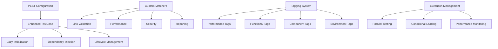

# Advanced PEST Test Suite Documentation

Welcome to the comprehensive PEST test suite for the validate-links project. This documentation covers the advanced testing infrastructure that provides lazy initialization, dependency injection, custom matchers, comprehensive tagging, parallel execution, and performance monitoring.

## 🚀 Quick Start

```bash
# Run all tests
pest

# Run specific test suites
pest tests/Unit
pest tests/Feature
pest tests/Integration

# Run tests with tags
pest --group=fast
pest --group=validation
pest --exclude-group=slow

# Run performance tests (excluded by default)
INCLUDE_PERFORMANCE_TESTS=true pest tests/Performance

# Run with parallel execution
pest --parallel

# Generate coverage report
pest --coverage
```

## 📋 Table of Contents

- [Architecture Overview](#architecture-overview)
- [Quick Start Guide](#quick-start-guide)
- [Key Features](#key-features)
- [Test Organization](#test-organization)
- [Advanced Patterns](#advanced-patterns)
- [Performance Testing](#performance-testing)
- [Migration Guide](#migration-guide)
- [Developer Guides](#developer-guides)
- [Reference Documentation](#reference-documentation)

## 🏗️ Architecture Overview

The test suite is built on a foundation of advanced PEST patterns and modern testing practices:



### Core Components

1. **[`PestTestCase`](tests/Support/PestTestCase.php:18)** - Enhanced base test case with all advanced features
2. **[Lazy Initialization](tests/Support/Traits/LazyInitialization.php:13)** - Memory-efficient deferred object creation
3. **[Dependency Injection](tests/Support/Traits/DependencyInjection.php)** - Advanced test double management
4. **[Custom Matchers](tests/Support/Matchers/)** - 80+ domain-specific assertions
5. **[Tagging System](tests/Support/Tags/)** - Comprehensive test organization and filtering
6. **[Parallel Testing](tests/Support/Parallel/)** - Safe concurrent test execution
7. **[Performance Monitoring](tests/Support/Lifecycle/)** - Built-in performance tracking

## 🎯 Key Features

### ✨ Lazy Initialization

Deferred object creation using PEST's [`let()`](tests/Support/Traits/LazyInitialization.php:32) pattern:

```php
// Define lazy properties
$this->let('expensiveService', fn() => new ExpensiveService());
$this->let('testData', fn() => $this->generateLargeDataset());

// Access when needed (created on first access)
$service = $this->lazy('expensiveService');
$data = $this->testData; // Magic method access
```

### 🔧 Dependency Injection

Advanced test double management with automatic cleanup:

```php
// Create and bind mocks with complex behaviors
$mock = $this->bindMock(ServiceInterface::class, [
    'method' => 'return_value',
    'complexMethod' => [
        'with' => ['param1', 'param2'],
        'andReturn' => 'result',
        'times' => 2,
    ],
]);

// Create spies and partial mocks
$spy = $this->spy(ServiceInterface::class);
$partial = $this->partialMock(ConcreteClass::class);
```

### 🏷️ Comprehensive Tagging

25+ tags across 5 categories for precise test execution:

```php
// Performance tags
uses()->group('performance', 'benchmark', 'memory')->in('Performance');

// Functional tags
uses()->group('unit', 'fast', 'parallel')->in('Unit');

// Component tags
uses()->group('validation', 'security', 'reporting')->in('Feature');

// Environment tags
uses()->group('ci', 'external', 'sequential')->in('Integration');

// Quality tags
uses()->group('smoke', 'critical', 'edge_case')->in('E2E');
```

### 🎯 Custom Matchers

80+ domain-specific matchers for clear, expressive assertions:

```php
// Link validation matchers
expect($result)->toBeValidLink();
expect($result)->toHaveHttpStatus(200);
expect($collection)->toHaveSuccessRate(0.95);

// Performance matchers
expect($callback)->toCompleteWithin(1.0);
expect($operation)->toUseMemoryLessThan(10 * 1024 * 1024);
expect($result)->toBePerformant();

// Security matchers
expect($url)->toBeSecure();
expect($response)->toHaveSecurityHeaders();
expect($content)->toPassSecurityCheck();

// Reporting matchers
expect($report)->toMatchReportFormat('json');
expect($report)->toContainValidationResults();
expect($report)->toBeValidReport();
```

### ⚡ Parallel Testing

Safe concurrent execution with proper isolation:

```php
// Parallel-safe test data creation
$testData = ParallelTestManager::createTestData('validation', [
    'urls' => ['https://example.com'],
]);

// Exclusive resource access
ParallelTestManager::withExclusiveAccess('shared_resource', function () {
    // Critical section code
});

// Database transaction isolation
ParallelTestManager::beginTestTransaction();
// Test code
ParallelTestManager::rollbackTestTransaction();
```

### 📊 Performance Monitoring

Built-in performance tracking and analysis:

```php
// Record performance checkpoints
$this->recordCheckpoint('setup_complete');

// Measure specific operations
$result = $this->measurePerformance(function () {
    return $this->expensiveOperation();
}, 'expensive_op');

// Assert performance thresholds
$this->assertPerformance('expensive_op', 1.0, 10 * 1024 * 1024);

// Performance wrapper
$result = $this->assertPerformant(function () {
    return $this->quickOperation();
}, 0.1, 1024 * 1024);
```

## 📁 Test Organization

### Directory Structure

```
tests/
├── Unit/                    # Unit tests (fast, parallel)
├── Feature/                 # Feature tests (medium speed)
├── Integration/             # Integration tests (sequential)
├── E2E/                     # End-to-end tests (slow, external)
├── Architecture/            # Architecture tests (fast)
├── Performance/             # Performance tests (excluded by default)
├── Examples/                # Usage examples
└── Support/                 # Test infrastructure
    ├── Builders/            # Builder pattern implementations
    ├── Doubles/             # Advanced test doubles
    ├── Factories/           # Data factories
    ├── Helpers/             # Utility helpers
    ├── Integration/         # Integration utilities
    ├── Lifecycle/           # Lifecycle management
    ├── Matchers/            # Custom matchers
    ├── Organization/        # Test organization tools
    ├── Parallel/            # Parallel testing support
    ├── Tags/                # Tagging system
    └── Traits/              # Core traits
```

### Naming Conventions

The test suite follows standardized naming conventions:

```php
// Behavior-driven naming
it_should_validate_url_when_url_is_valid();
it_should_return_error_when_url_is_invalid();
it_should_timeout_when_request_takes_too_long();

// Validation testing
it_validates_email_format_correctly();
it_validates_url_structure_correctly();

// Error handling
it_throws_validation_exception_when_url_is_malformed();
it_throws_timeout_exception_when_request_exceeds_limit();

// Performance testing
it_completes_validation_within_one_second();
it_completes_batch_processing_within_five_seconds();
```

## 🔄 Advanced Patterns

### Builder Pattern

Fluent interface for complex object creation:

```php
use Tests\Support\Builders\ValidationConfigBuilder;

// Simple usage
$config = ValidationConfigBuilder::create()
    ->withTimeout(30)
    ->withMaxRedirects(5)
    ->build();

// Complex configuration
$config = ValidationConfigBuilder::create()
    ->forFastTesting()
    ->withScopes([ValidationScope::EXTERNAL])
    ->addHeader('Authorization', 'Bearer token')
    ->withExcludePatterns(['*.pdf'])
    ->build();

// Predefined configurations
$fastConfig = ValidationConfigBuilder::create()->forFastTesting()->build();
$ciConfig = ValidationConfigBuilder::create()->forCI()->build();
```

### Advanced Test Doubles

Realistic test doubles with state management:

```php
use Tests\Support\Doubles\TestDoubleFactory;

// Link validation with realistic behavior
$linkValidation = TestDoubleFactory::linkValidationWithState([
    'valid_urls' => ['https://example.com'],
    'broken_urls' => ['https://broken.com'],
]);

// Security validation with custom rules
$security = TestDoubleFactory::securityValidationWithRules([
    'blocked_domains' => ['malicious.com'],
    'allowed_protocols' => ['https'],
]);

// Failing services for error testing
$failing = TestDoubleFactory::failingService(ServiceInterface::class, [
    'method' => new Exception('Simulated failure'),
]);

// Slow services for performance testing
$slow = TestDoubleFactory::slowService(ServiceInterface::class, [
    'method' => 500, // 500ms delay
]);
```

## 🚀 Performance Testing

Performance tests are segregated and excluded by default for faster regular test runs:

### Running Performance Tests

```bash
# Run performance tests explicitly
pest tests/Performance/

# Include in regular runs
INCLUDE_PERFORMANCE_TESTS=true pest

# Run with performance reporting
PEST_PERFORMANCE_REPORT=true pest tests/Performance/
```

### Performance Test Structure

```php
use Tests\Support\PestTestCase;

uses(PestTestCase::class);

describe('Link Validation Performance', function () {
    it_completes_single_validation_within_100ms()
        ->group('performance', 'fast')
        ->expect(function () {
            return $this->linkValidation->validateLink('https://example.com');
        })->toCompleteWithin(0.1);
    
    it_processes_batch_validation_efficiently()
        ->group('performance', 'memory')
        ->expect(function () {
            $urls = array_fill(0, 100, 'https://example.com');
            return $this->linkValidation->validateLinks($urls);
        })->toUseMemoryLessThan(50 * 1024 * 1024); // 50MB
});
```

## 📚 Migration Guide

### From Existing Tests

To migrate existing tests to use the new infrastructure:

1. **Extend Enhanced TestCase**:
   ```php
   // Before
   use Tests\TestCase;
   
   // After
   use Tests\Support\PestTestCase;
   ```

2. **Replace Manual Mock Creation**:
   ```php
   // Before
   $mock = mock(ServiceInterface::class);
   $mock->shouldReceive('method')->andReturn('value');
   
   // After
   $mock = $this->bindMock(ServiceInterface::class, [
       'method' => 'value',
   ]);
   ```

3. **Use Builder Patterns**:
   ```php
   // Before
   $config = new ValidationConfig(/* many parameters */);
   
   // After
   $config = ValidationConfigBuilder::create()
       ->forFastTesting()
       ->build();
   ```

4. **Add Performance Monitoring**:
   ```php
   // Before
   $result = $service->process($data);
   
   // After
   $result = $this->assertPerformant(function () use ($service, $data) {
       return $service->process($data);
   }, 1.0, 10 * 1024 * 1024);
   ```

5. **Apply Tags**:
   ```php
   // Add appropriate tags to test files
   uses()->group('unit', 'fast', 'parallel')->in('Unit');
   uses()->group('validation', 'security')->in('Feature');
   ```

## 📖 Documentation Structure

This documentation is organized into several sections:

- **[Feature Guides](docs/features/)** - Detailed guides for each major feature
- **[Usage Examples](docs/examples/)** - Practical examples and tutorials
- **[Developer Guides](docs/guides/)** - Setup, debugging, and contribution guides
- **[Reference](docs/reference/)** - Complete API reference and troubleshooting

### Feature-Specific Documentation

- [Lazy Initialization Guide](docs/features/lazy-initialization.md)
- [Dependency Injection Guide](docs/features/dependency-injection.md)
- [Custom Matchers Reference](docs/features/custom-matchers.md)
- [Tagging System Guide](docs/features/tagging-system.md)
- [Parallel Testing Guide](docs/features/parallel-testing.md)
- [Performance Testing Guide](docs/features/performance-testing.md)
- [Test Organization Guide](docs/features/test-organization.md)

### Usage Examples

- [Basic Usage Examples](docs/examples/basic-usage.md)
- [Advanced Patterns Examples](docs/examples/advanced-patterns.md)
- [Performance Testing Examples](docs/examples/performance-testing.md)
- [Integration Testing Examples](docs/examples/integration-testing.md)

### Developer Guides

- [Environment Setup Guide](docs/guides/setup.md)
- [Running Tests Guide](docs/guides/running-tests.md)
- [Debugging Guide](docs/guides/debugging.md)
- [Contributing Guide](docs/guides/contributing.md)
- [Extending Infrastructure Guide](docs/guides/extending.md)

### Reference Documentation

- [Complete Matchers Reference](docs/reference/matchers.md)
- [Tags Reference](docs/reference/tags.md)
- [Configuration Reference](docs/reference/configuration.md)
- [Troubleshooting Guide](docs/reference/troubleshooting.md)
- [Performance Tuning Guide](docs/reference/performance-tuning.md)

## 🔧 Configuration

The test suite is configured via [`pest.config.php`](pest.config.php:16) with comprehensive options:

```php
// Key configuration sections
'lazy_initialization' => [
    'enabled' => true,
    'cache_instances' => true,
    'auto_cleanup' => true,
    'memory_threshold' => '50M',
],

'test_doubles' => [
    'auto_cleanup' => true,
    'state_management' => true,
    'realistic_behaviors' => true,
],

'tagging' => [
    'enabled' => true,
    'auto_discovery' => true,
    'default_exclusions' => ['performance', 'slow', 'external'],
],

'parallel' => [
    'processes' => min(8, (int) shell_exec('nproc') ?: 4),
    'isolation_mode' => 'process',
    'database_strategy' => 'transaction',
],
```

## 🤝 Contributing

When contributing new tests:

1. Follow the established naming conventions
2. Use appropriate tags for test categorization
3. Leverage the advanced patterns (lazy initialization, builders, etc.)
4. Add performance monitoring for critical tests
5. Ensure parallel safety for unit and feature tests
6. Update documentation for new features

## 📊 Performance Metrics

The test suite includes built-in performance monitoring:

```bash
# View performance report
PEST_PERFORMANCE_REPORT=true pest

# Export detailed metrics
pest --export-metrics=json
```

## 🔍 Troubleshooting

Common issues and solutions:

- **Slow test execution**: Check for missing `parallel` tags or heavy setup in `beforeEach`
- **Memory issues**: Use lazy initialization and proper cleanup
- **Flaky tests**: Ensure proper test isolation and avoid shared state
- **Parallel test failures**: Check for unsafe tags and shared resources

## 📝 License

This test infrastructure is part of the validate-links project and follows the same licensing terms.

---

For detailed information on specific features, see the feature-specific documentation in the [`docs/`](docs/) directory.